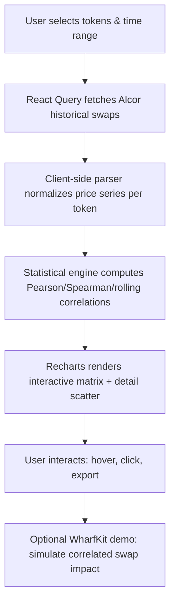

# wax-token-correlation-coefficient-chart — Alcor Token Correlation Matrix

> **Status:** 🔒 Private (In Development) | Target Public Release: August 2026  
> **Category:** Advanced DeFi & Concentrated Liquidity Visualizers (Alcor v2)  
> **Parent Catalog:** [pixel-journey/wax-ecosystem-blueprint-catalog](https://github.com/pixel-journey/wax-ecosystem-blueprint-catalog)

**One-sentence goal:** A correlation plotting matrix tool that parses historical Alcor swap rates to show the mathematical price dependencies between community gaming tokens and native WAX.

---

## 1. Overview & Goal

This blueprint delivers an interactive correlation matrix and scatter plot explorer that ingests historical swap data from Alcor (the primary DEX on WAX) to compute and visualize Pearson, Spearman, and rolling-window correlation coefficients between any pair of tokens — with special focus on gaming ecosystem tokens vs WAX and major stables.

**Why it matters for WAX/Antelope:**
- WAX has a vibrant gaming economy with many community tokens that often move in correlated or inverse patterns with WAX price and liquidity events.
- Understanding these relationships helps LP providers, traders, game devs, and DAO treasuries make data-driven decisions about hedging, diversification, and timing of large swaps.
- Exclusively uses **public infrastructure**: Alcor public REST endpoints for historical swaps, Hyperion for enriched action data if needed, no custom contracts.

**Target users:** DeFi traders, liquidity providers on Alcor, game economy analysts, portfolio managers, and educational explorers of on-chain market microstructure.

**Success metrics:**
- Load and render correlation matrix for 20+ tokens in < 2s
- Accurate coefficient calculation matching statistical libraries
- Beautiful, interactive Recharts/D3 visualizations with exportable insights
- Clear educational explanations of statistical concepts tailored to WAX tokenomics

---

## 2. Concepts & Inspiration

**Core blockchain concepts:**
- Alcor AMM uses concentrated liquidity (v2) with tick math; historical swap events are indexed publicly.
- Token prices on WAX are derived from swap rates in pools (often WAX/token or stable/token).
- Correlation in DeFi context: how two assets' prices co-move, useful for portfolio optimization, pair trading, and understanding systemic risk in gaming token economies.

**User pain points:**
- No easy way to see which gaming tokens are highly correlated with WAX (risk concentration) or inversely correlated (hedge opportunities).
- Traders manually check multiple Alcor pair charts; this blueprint unifies it into a matrix view.

**Inspirations:**
- Traditional finance: Correlation matrices in Bloomberg terminals and portfolio analytics dashboards (e.g., Yahoo Finance, TradingView).
- Web3: Dune Analytics correlation queries, but made beautiful and WAX-specific with client-side computation.
- Cross-references: Pairs beautifully with `wax-alcor-v2-liquidity-density-heatmap`, `wax-lp-impermanent-loss-heat-map`, `wax-yield-farming-opportunity-aggregator`, and `wax-market-cap-bubble`.

---

## 3. Design Specifications (Pixel Journey Standards)

### 3.1 Visual & Interaction Design
- Clean dashboard with sidebar token selector + main canvas area for matrix and detail charts.
- Pixel Journey Design System: Modern dark theme with emerald/amber accents for positive/negative correlations, Tailwind + shadcn/ui cards, subtle framer-motion transitions.
- Pixel-art subtle accents on gaming tokens where appropriate, but primarily clean modern Web3 aesthetic.
- Micro-interactions: Hover on matrix cell highlights row/column and shows tooltip with exact coefficient + sample size.
- Responsive: Desktop-first matrix, mobile collapses to list or simplified scatter.

### 3.2 Key Views / Components
- `CorrelationMatrix.tsx` — Interactive heatmap grid (Recharts or custom canvas) with sortable tokens, color scale from -1 (red) to +1 (emerald).
- `ScatterDetail.tsx` — Clickable cell opens detailed scatter plot with regression line, rolling correlation over time.
- `TokenSelector.tsx` — Multi-select chips or searchable list of Alcor-traded tokens, with quick "Gaming Tokens" and "Majors" presets.
- `TimeRangeControls.tsx` — Preset ranges (7d, 30d, 90d, All) + custom date picker, triggers data refetch.
- `ExportPanel.tsx` — Download CSV of coefficients, PNG/SVG of current view, shareable link with encoded state.

### 3.3 Accessibility (A11y) & Inclusive Design
- WCAG 2.2 AA: High contrast color scales (pattern + color for colorblind safety), keyboard navigation on matrix (arrow keys move focus, Enter opens detail), screen reader announcements for selected correlation values.
- Reduced motion mode supported.
- Low bandwidth: Option to load summarized data only.

### 3.4 Performance & Optimization Targets
- Lighthouse 95+ on desktop.
- Data fetching cached with React Query, background refetch on interval.
- Virtualization for large token lists.
- Bundle budget < 250kb initial.

---

## 4. Technical Architecture

### 4.1 Core Tech Stack (Standardized)
- **Framework:** Next.js 15 (App Router) + TypeScript (strict)
- **Styling:** Tailwind CSS + shadcn/ui + framer-motion
- **State & Data:** @tanstack/react-query + zod validation + jotai for UI state
- **Wallet & Signing:** @wharfkit/session (for any optional "simulate swap" demo mode)
- **Blockchain Data:**
  - Alcor public API / historical swaps (REST endpoints for pair history)
  - Hyperion (https://api.waxsweden.org) for enriched swap actions if deeper parsing needed
  - Client-side computation of correlations (no server)
- **Visualization:** Recharts for matrix/heatmaps + D3.js or custom Canvas for advanced radar/scatter if needed
- **Utilities:** date-fns, lucide-react, sonner toasts, papaparse for CSV export

### 4.2 Data Flow Diagram (Mermaid)


### 4.3 Folder Structure (Recommended)
```
app/
├── (dashboard)/
│   └── page.tsx                 # Main correlation explorer
├── components/
│   ├── correlation/
│   │   ├── CorrelationMatrix.tsx
│   │   ├── ScatterDetailModal.tsx
│   │   └── TokenSelector.tsx
├── hooks/
│   ├── useAlcorSwapHistory.ts
│   └── useCorrelationEngine.ts
├── lib/
│   ├── wax/
│   │   ├── alcor-client.ts      # Typed fetchers for public Alcor endpoints
│   │   └── correlation.ts       # Pure statistical functions (Pearson, etc.)
│   └── utils.ts
├── types/
│   └── index.ts                 # Token, Swap, Correlation interfaces
public/
└── mock-data/                   # Realistic sample datasets for demo mode
```

### 4.4 Security & Privacy Notes
- All computation client-side; no sensitive data sent to servers.
- Public data only.
- Clear disclaimers on statistical nature (correlation ≠ causation).

---

## 5. Implementation Examples & Code Snippets

**1. Core data fetching hook (useAlcorSwapHistory.ts)**
```ts
import { useQuery } from '@tanstack/react-query';

export function useAlcorSwapHistory(pair: string, days: number) {
  return useQuery({
    queryKey: ['alcor-swaps', pair, days],
    queryFn: async () => {
      const res = await fetch(`https://api.alcor.exchange/api/swaps?pair=${pair}&days=${days}`);
      return res.json();
    },
    staleTime: 1000 * 60 * 5,
  });
}
```

**2. Client-side correlation engine (lib/wax/correlation.ts)**
```ts
import { pearsonCorrelation, spearmanCorrelation } from 'simple-statistics'; // or custom impl

export function computeCorrelationMatrix(priceSeries: Record<string, number[]>) {
  // Returns matrix of coefficients
}
```

**3. Key visualization component (CorrelationMatrix.tsx)**
```tsx
import { Heatmap } from 'recharts'; // or custom
// Renders color-coded grid with tooltips
```

**4. WharfKit demo snippet** (optional "what if I swap now" impact simulation using current correlation).

**5. Offline/fallback** — Full mock data mode with realistic WAX gaming token correlations pre-loaded.

---

## 6. Demo & Testing Strategy

- **Live Demo Toggle:** Mock Data ↔ Mainnet (clear "LIVE" badge, rate-limited to public endpoints)
- Storybook for components
- Playwright e2e for matrix interaction flows
- Vitest for statistical engine accuracy tests
- Vercel preview on every PR

---

## 7. Roadmap & Development Phases

**Phase 0 — Scaffold (1–2 days)**
- Next.js 15 + Tailwind + shadcn + WharfKit wrapper + basic layout from Design System

**Phase 1 — Data Layer (3–5 days)**
- Alcor public API client, TypeScript types, price series normalization, caching

**Phase 2 — Core UI Components (5–7 days)**
- Interactive matrix (Recharts), detail scatter with regression, time controls, token presets

**Phase 3 — Polish & Edge Cases (3–4 days)**
- Loading/error/empty states, a11y audit, performance (virtualization), responsive

**Phase 4 — Documentation & Release Prep (2 days)**
- Full README, screenshots/GIFs, AI prompt pack, make public, update catalog

**Future Enhancements**
- Integration with other Alcor blueprints (heatmap, range optimizer)
- Advanced stats (Granger causality, cointegration tests)
- Multi-chain comparison (if bridge data available)
- Mobile PWA + shareable correlation reports

---

## 8. Visual References & Mockups

The main view should feel like a Bloomberg correlation matrix meets a modern Dune Analytics dashboard — clean, information-dense, but delightful.

> Matrix cells use a diverging color scale (red negative, white zero, emerald positive). Hovering a cell highlights the pair and shows exact r-value + p-value + data points. Clicking opens a modal with time-series scatter, best-fit line, and rolling correlation chart. Sidebar allows quick filtering to "Gaming Tokens Only" or "High Liquidity Pairs".

ASCII inspiration:
```
          WAX   PIXEL   SHROOM   ... 
WAX      1.00   0.72   -0.15
PIXEL    0.72   1.00    0.45
SHROOM  -0.15   0.45    1.00
```

---

## 9. Related Blueprints & Ecosystem Fit

- `wax-alcor-v2-liquidity-density-heatmap` — Perfect companion for understanding liquidity context around correlated moves.
- `wax-lp-impermanent-loss-heat-map` — Use correlation insights to choose safer LP ranges.
- `wax-yield-farming-opportunity-aggregator` — Correlated tokens may have linked yield opportunities.
- `wax-market-cap-bubble` — Visual context for which tokens are systemically important.
- `wax-defi-retention-metric-suite` — Broader health view that can incorporate correlation risk metrics.

---

## 10. License, Contributing & Credits

- MIT License
- Built with love for the WAX ecosystem using only public infrastructure (Alcor, Hyperion, WharfKit).
- Special thanks to Alcor team for excellent public APIs and the broader WAX developer community.
- Pixel Journey Design System attribution.

**Pixel Journey — Beautiful interfaces for public blockchain data.**
